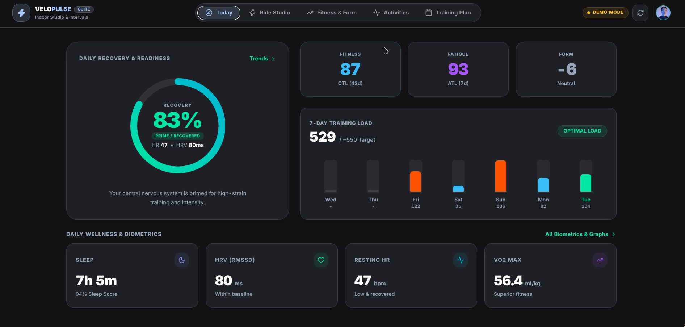
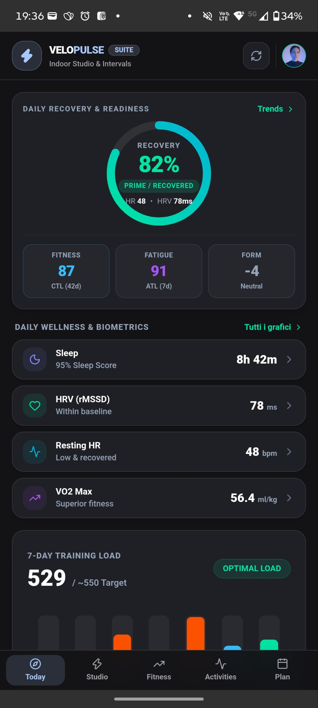
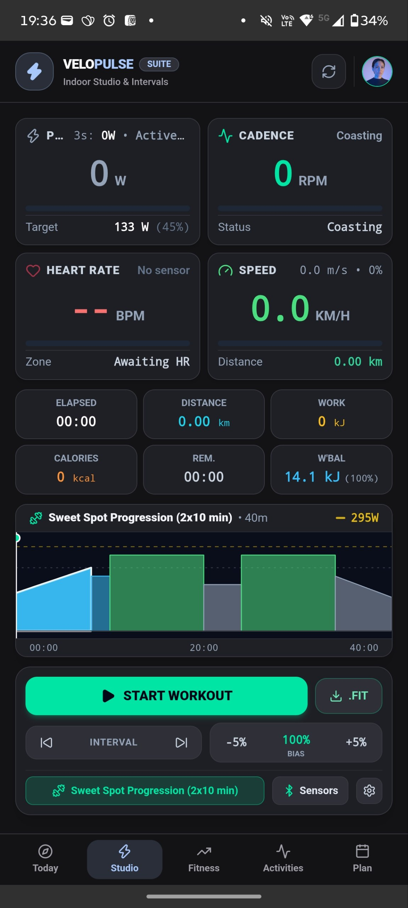
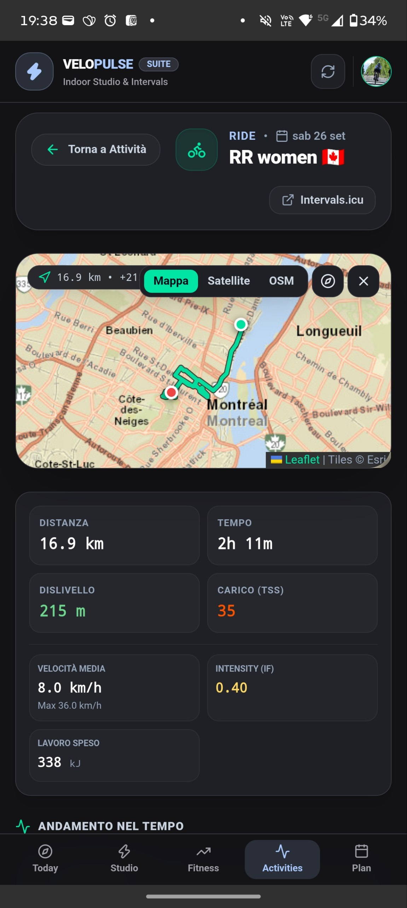
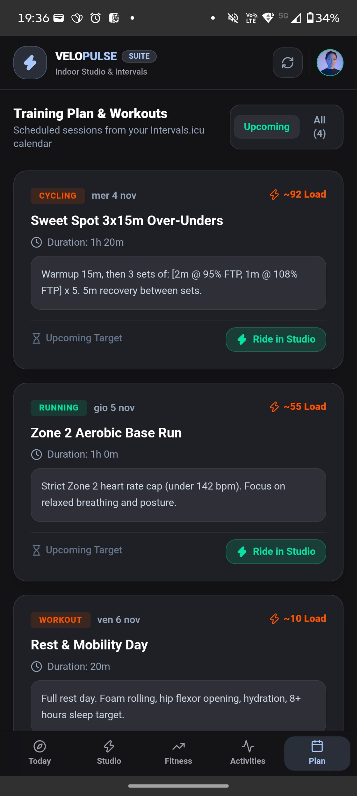
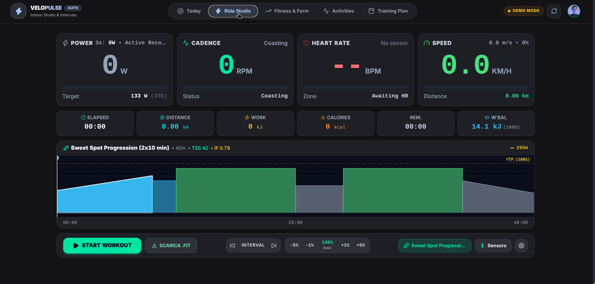
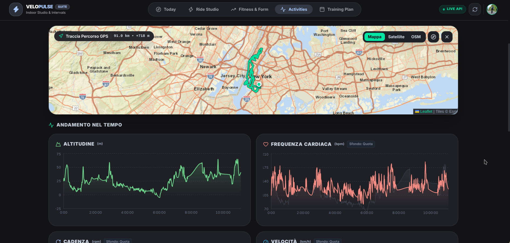
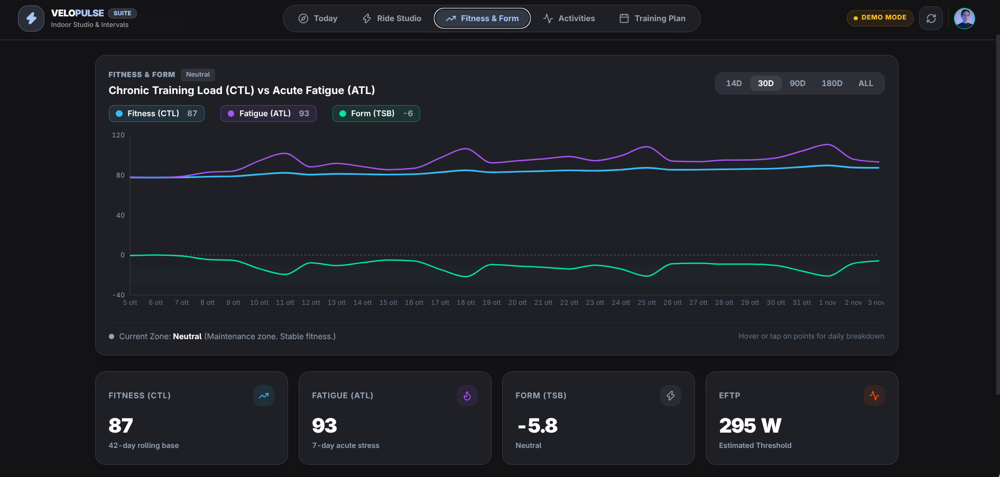

# VeloPulse | Smart Cycling Studio & Athletic Analytics

[](https://react.dev/)
[](https://www.typescriptlang.org/)
[](https://tailwindcss.com/)
[](https://capacitorjs.com/)
[](https://www.electronjs.org/)
[](https://leafletjs.com/)
[](https://developer.garmin.com/fit/overview/)

**VeloPulse** is a modern, unified indoor cycling studio and athletic performance analytics platform. It combines real-time smart trainer control, structured workout execution, and deep ride & recovery analytics—with support for **Strava**, **Intervals.icu**, and **Garmin `.fit`** files across all platforms.

Styled in a refined **Google Material 3 Dark theme** (charcoal scaffold `#131316`, surface containers, pill navigation, and Material You accents).

<p align="center">
  
</p>

---

## Cross-Platform Availability

VeloPulse runs natively or as an app on all major operating systems:

| Platform | Format | Description |
| :--- | :--- | :--- |
| **Android** | `.apk` | Native Capacitor BLE with background wake-lock and direct `.fit` export |
| **iOS** | Xcode Project | Native Capacitor iOS app with Bluetooth Central background capabilities |
| **Windows 11** | `.zip` (Portable) | Standalone desktop application with `VeloPulse.exe` |
| **macOS** | `.zip` (`.app`) | macOS standalone desktop application bundle |
| **Linux** | `.AppImage` / `.tar.gz` | Universal Linux binaries + `VeloPulse-Linux.sh` launcher |
| **Web** | Web App | Modern PWA/SPA optimized for Chrome, Edge, and Chromium |

All pre-compiled packages are available in the [GitHub Releases](https://github.com/frr0/Cycling-App/releases) section.

<p align="center">
  
  
  
  
</p>

### Live demo

The web app is also hosted as a running demo: [DEMO](<https://velopulse-demo.institorai.app/__institor/demo/enter#k=0B2mB02-YBi1_4lHikqBdv7xWkZH9uGAraAuEun4Sxw>)

The demo is private. It opens with the share link from the project owner; without that link
the address shows a "Private demo" page instead of the app.

---

## Key Features

### 1. Indoor Smart Trainer & Ride Studio

<p align="center">
  
</p>

* **Bluetooth Sensor Connectivity**:
  * **Smart Trainer (FTMS & Cycling Power)**: Connects via Bluetooth FTMS (`0x1826`) or Cycling Power (`0x1818`). Live instantaneous power (W), 3-second smoothing, cadence (RPM), and hardware flywheel speed.
  * **Bluetooth Cadence Sensor**: Dedicated crank cadence sensor support (`0x1816`).
  * **Bluetooth Heart Rate Monitor**: Live BPM, HR zones, and HR intensity tracking (`0x180D`).
  * **Virtual Cyclist Simulator Mode**: Built-in simulator to test and execute workouts without requiring physical bike hardware.
* **Advanced Cycling Physics Engine**:
  * Calculates real-world road velocity and distance using aerodynamic drag ($C_d A$), rolling resistance ($C_{rr}$), rider weight, bike weight, and road gradient:
    $$F_{drive} = \frac{P_{watts} \cdot \eta}{v}, \quad F_{resist} = 0.5 \cdot \rho \cdot C_d A \cdot v^2 + C_{rr} \cdot m \cdot g + m \cdot g \cdot \sin(\theta)$$
  * Toggle between **Virtual Physics Speed** and **Flywheel Speed**.
* **Zwift (.zwo) Workout Runner & Auto ERG Control**:
  * Execute custom Zwift `.zwo` XML workouts or built-in presets (Sweet Spot Progression, VO2 Max Boost, Over-Under Threshold, FTP Ramp Test, Active Recovery).
  * Automatically transmits target wattage to smart trainers via Bluetooth FTMS Control Point (`0x2AD9`).
  * Live ERG Bias adjustment (-20% to +20%) and interval skip forward/backward.
  * Multi-tone audio countdown beeps on interval transitions.
* **Garmin .FIT Activity File Generator**:
  * Generates 100% compliant `.fit` binary activity files using `@garmin/fitsdk`.
  * Second-by-second records with power, cadence, heart rate, speed, distance, normalized power, TSS, and IF.
  * Supports saving in-progress / partial session data even if stopped early.
  * Ready for 1-click upload to **Strava**, **Garmin Connect**, and **Intervals.icu**.

---

### 2. Dedicated Activity Page & Interactive GPS Route Map

<p align="center">
  
</p>

* **Dedicated Two-Column Activity View**:
  * Opening any activity from the Dashboard or Activities list navigates to a dedicated page (`ActivityDetailView`) with integrated breadcrumb navigation and `Escape` keyboard shortcut.
  * **Left column**: interactive GPS route map (expandable to fullscreen), compact key metrics summary, and Heart Rate & Power zone distributions.
  * **Right column**: synchronized telemetry charts over time (altitude, heart rate, power, cadence, speed, and W'bal reserve), each expandable to fullscreen, plus aerobic decoupling analysis.
* **Interactive Leaflet Route Map**:
  * Decodes GPS tracks from `.fit` files, Strava polylines, and Intervals.icu streams.
  * Street, Satellite, and OpenStreetMap layer switcher with recenter and fullscreen expand controls.
  * Custom **START** and **FINISH** markers plus a live cursor synced with the telemetry charts.
  * Distance & elevation badge overlays.
* **Comprehensive Metrics**:
  * Distance, duration, elevation gain, TSS, average/normalized power (NP), Intensity Factor (IF), work (kJ), speed, cadence, and heart rate.
  * **Heart Rate Zones**: stacked distribution and detailed time-in-zone breakdown.
  * **Power Zones**: 7-zone Coggan power model.
  * **Structured Intervals**: work and recovery intervals table with average wattage and heart rate.
  * **Athlete Notes & Exertion**: RPE (1-10) and feel indicators.

---

### 3. Athletic Performance & Recovery Analytics

<p align="center">
  
</p>

* **Multi-Source Sync & Demo Mode**:
  * Connect **Intervals.icu**, link **Strava** via OAuth, or import **Garmin `.fit`** files directly—or explore immediately in demo mode.
* **Customizable Heart Rate & Power Zones**:
  * Configure custom HR zones (min/max BPM, names, colors) and FTP in Settings.
* **Daily Readiness & Recovery Ring**:
  * Daily recovery score computed from real recorded HRV ($rMSSD$), resting heart rate, sleep metrics, and readiness.
* **Fitness & Form Modeling (CTL / ATL / TSB)**:
  * **Fitness (CTL)**: 42-day rolling chronic training load.
  * **Fatigue (ATL)**: 7-day rolling acute training load.
  * **Form (TSB)**: $CTL - ATL$ with highlighted optimal performance zones.
* **Power Duration Curve & Critical Power**:
  * Mean maximal power curve across Sprint (5s/15s), Anaerobic (30s/1m), VO2 Max (2m/5m), Threshold (10m/20m), and Endurance (1h), with 2-parameter Critical Power (CP) and W' estimation.
* **Biometrics & Wellness Trends**:
  * Longitudinal tracking for VO2max, HRV ($rMSSD$), Resting Heart Rate, and Sleep Duration/Quality—displaying only recorded values with zero fabricated fallbacks.
* **Calendar & Workout Planner**:
  * View scheduled workouts with planned TSS and targets.
  * **"Ride in Studio"** button: instantly converts any scheduled workout into ERG intervals and loads it directly into the Smart Trainer HUD.

---

### 4. Google Material 3 Dark Theme
* **Color Palette**:
  * Background Scaffold: `#131316` (deep charcoal)
  * Surface Container: `#1F2025`
  * Surface Container High: `#26272D`
  * Surface Container Highest: `#2F3037`
  * Outline Variant / Borders: `#383941`
  * Primary Accent: `#A8C7FA` (Material You Blue)
  * Secondary / Mint Accent: `#6DD58C` / `#00E5A3`
  * Warning Accent: `#FDD663`
  * Error / Coral Accent: `#F28B82`
* **Pill Navigation & Cards**:
  * Floating pill navigation bar on desktop and mobile.
  * High-contrast typography and subtle rounded elevation cards.

---

## Downloads & Installation

Pre-built binaries can be downloaded directly from the [GitHub Releases](https://github.com/frr0/Cycling-App/releases) page:

### Android
1. Download `VeloPulse.apk`.
2. Sideload onto your device:
   ```bash
   adb install -r VeloPulse.apk
   ```
3. Grant Bluetooth and Location permissions when prompted.

### Windows 11
1. Download `VeloPulse-win-x64.zip`.
2. Extract the archive and launch `VeloPulse.exe`.

### macOS
1. Download `VeloPulse-mac-x64.zip`.
2. Extract and move `VeloPulse.app` to your `/Applications` folder.

### Linux
1. Download `VeloPulse-linux-x86_64.AppImage` (or `VeloPulse-linux-x64.tar.gz`).
2. Make it executable and run:
   ```bash
   chmod +x VeloPulse-linux-x86_64.AppImage
   ./VeloPulse-linux-x86_64.AppImage --appimage-extract-and-run --no-sandbox
   ```
   *Or simply run the included universal launcher script:*
   ```bash
   ./VeloPulse-Linux.sh
   ```

---

## Development & Building from Source

### Prerequisites
* **Node.js**: v18+ or v20+
* **npm**: v9+
* **JDK 21**: Required for compiling the Android APK (`JAVA_HOME=~/.local/jdk21`)
* **Xcode 15+**: Required for compiling the iOS app (macOS only)

### Installation
```bash
git clone https://github.com/frr0/Cycling-App.git
cd Cycling-App
npm install
```

### Run Web Development Server
```bash
npm run dev
```
Open [http://localhost:5173](http://localhost:5173) in Chrome, Edge, or Chromium.

### Run with Docker (Recommended for Local Dev)
Copy `.env.example` to `.env.local` (add your `VITE_SUPABASE_URL` and `VITE_SUPABASE_ANON_KEY`), then:
```bash
# Start local dev server with hot-reload (http://localhost:5173)
make up        # or: docker compose up

# Rebuild image and start dev server (e.g. after package.json changes)
make build     # or: docker compose up --build

# Build and preview production bundle via nginx (http://localhost:8080)
make prod      # or: docker compose --profile prod up --build

# Stop containers
make down      # or: docker compose --profile prod down
```

### Build Production Web Assets
```bash
npm run build
```

### Build Linux Desktop (AppImage & Tarball)
```bash
npm run dist:linux
```

### Build Windows 11 Desktop (Zip & Directory)
```bash
npm run dist:win
```

### Build macOS Desktop (Zip & App Bundle)
```bash
npm run dist:mac
```

### Build Android APK
```bash
npm run android:build
```
Outputs the ready-to-install `VeloPulse.apk`.

### Build iOS Native Project
```bash
npm run ios:sync
npm run ios:open
```
Opens the project in Xcode for signing and deployment to physical iPhones or iPads.

---

## Repository Structure

```
Cycling/
├── android/                     # Capacitor native Android project (Gradle, BLE permissions, FIT export)
├── ios/                         # Capacitor native iOS project (Xcode project, Info.plist BLE capabilities)
├── electron/                    # Electron desktop runtime (Web Bluetooth, window management)
│   ├── assets/icon.png          # App icon (512x512)
│   └── main.cjs                 # Main Electron process
├── src/
│   ├── components/
│   │   ├── charts/              # Recharts components (Power Curve, HRV, Sleep, VO2 Max, Resting HR)
│   │   ├── views/               # App views (Dashboard, RideStudio, Fitness, Activities, ActivityDetail, Calendar, Profile)
│   │   ├── ActivityMap.tsx      # Leaflet interactive GPS map with Dark Matter & OSM tiles
│   │   ├── Navbar.tsx           # Google Material 3 pill navigation bar
│   │   ├── MetricCard.tsx       # Studio HUD telemetry cards
│   │   └── ...                  # Modals (Bluetooth, Settings, SessionSummary)
│   ├── context/                 # AppContext (authentication, multi-provider sync, app state)
│   ├── services/
│   │   ├── bluetooth/           # FTMS, Cycling Power, Cadence, HR BLE client & simulator
│   │   ├── physics/             # Real-time cycling physics engine (aero drag, rolling resistance, slope)
│   │   ├── workout/             # Zwift .zwo XML parser & real-time ERG workout runner
│   │   ├── fit/                 # Garmin .FIT binary encoder & parser (@garmin/fitsdk)
│   │   └── intervals/           # Intervals.icu integration & demo datasets
│   └── utils/                   # HR & Coggan power zones, critical power, polyline decoder, formatters
├── VeloPulse.apk                # Pre-compiled Android APK
├── VeloPulse-Linux.sh           # Universal launcher script for Linux systems
├── Dockerfile                   # Multi-stage Docker image (dev Vite HMR + prod nginx)
├── docker-compose.yml           # Local dev and production preview services
├── Makefile                     # Shortcuts: make up, make build, make prod, make down
├── package.json                 # Project dependencies and build scripts
├── tailwind.config.js           # Material 3 Dark color theme definitions
└── README.md                    # Project documentation
```

---

## License

This project is licensed under the MIT License.
