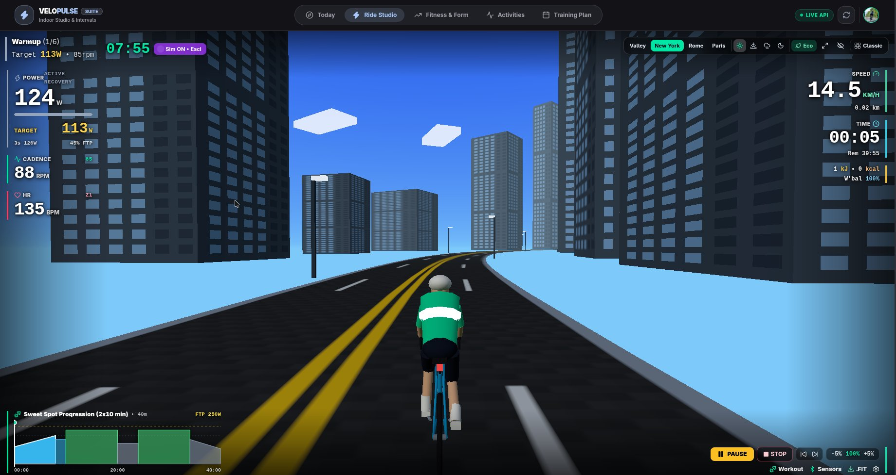
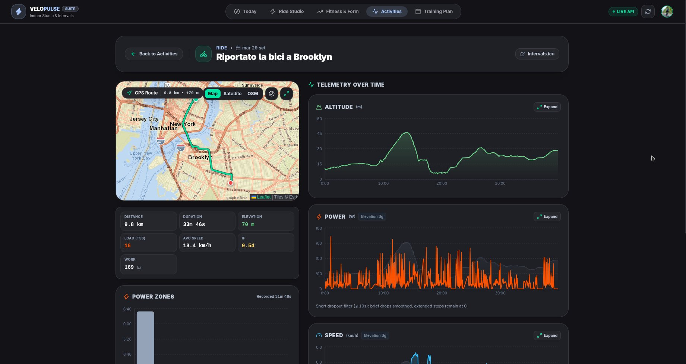
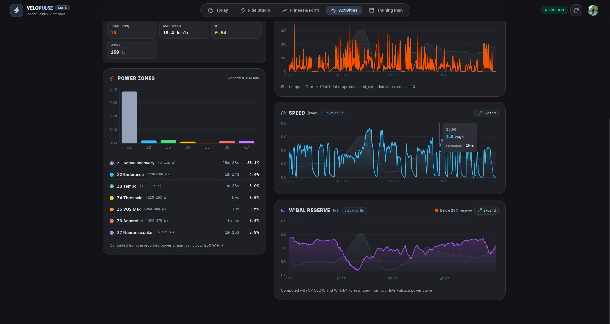

# VeloLab | Smart Cycling Studio & Athletic Analytics

[](https://react.dev/)
[](https://www.typescriptlang.org/)
[](https://tailwindcss.com/)
[](https://capacitorjs.com/)
[](https://leafletjs.com/)
[](https://threejs.org/)
[](https://developer.garmin.com/fit/overview/)

**VeloLab** is a modern, unified indoor cycling studio and athletic performance analytics platform. It combines a lightweight **full-screen 3D virtual road engine**, real-time smart trainer ERG control, structured workout execution, and deep ride & recovery analytics—with support for **Strava**, **Intervals.icu**, and **Garmin `.fit`** files across all platforms.

Styled in a refined **Google Material 3 Dark theme** (charcoal scaffold `#131316`, surface containers, pill navigation, Material You accents, and a frameless high-contrast 3D HUD).

<p align="center">
  
</p>

---

## Cross-Platform Availability

VeloLab runs in the browser on any computer and as a native app on phones:

| Platform | Format | Description |
| :--- | :--- | :--- |
| **Android** | `.apk` | Native Capacitor BLE with background wake-lock and direct `.fit` export |
| **iOS** | Xcode Project | Native Capacitor iOS app with Bluetooth Central background capabilities |
| **Web** | Web App | Full app for computers, in Chrome, Edge, and Chromium (Web Bluetooth) |

There are no separate desktop builds: on a computer, use the web app. On Linux, Chrome needs
Web Bluetooth enabled at `chrome://flags/#enable-web-bluetooth` to connect to sensors.

All pre-compiled packages are available in the [GitHub Releases](https://github.com/frr0/Cycling-App/releases) section.

<p align="center">
  
  &nbsp;&nbsp;
  
</p>

### Live demo

The web app is also hosted as a running demo: [DEMO](<https://velopulse-demo.institorai.app/__institor/demo/enter#k=0B2mB02-YBi1_4lHikqBdv7xWkZH9uGAraAuEun4Sxw>)

The demo is private. It opens with the share link from the project owner; without that link
the address shows a "Private demo" page instead of the app.

---

## Key Features

### 1. Lightweight 3D Road Studio & Smart Trainer Control

* **Lightweight Procedural 3D Graphics (Three.js)**:
  * **4 Stylized Low-Poly Worlds**: ride through **Valley** (scenic mountain loop), **New York** (Manhattan avenues, Empire State Building, Statue of Liberty, One WTC), **Rome** (sampietrini roads, umbrella pines, Colosseum, Arch of Constantine, St. Peter's Dome), and **Paris** (Haussmann boulevards, Eiffel Tower, Arc de Triomphe, Louvre Pyramid).
  * **4 Instant Lighting Themes**: switch between **Day**, **Golden Hour**, **Mist**, and **Night** (complete with glowing illuminated building windows, streetlamps, and bike headlight).
  * **Articulated 3D Cyclist & Live Peloton**: ride in a steady third-person chase view behind a road cyclist with realistic 2-segment inverse-kinematics pedaling and spinning spoked wheels, synchronized 1:1 with your real speed (stopping cleanly at 0 km/h), while overtaking and being overtaken by NPC riders.
  * **Ultra-Light Eco Mode**: zero heavy external texture downloads—all geometry is instanced (< 15 draw calls) with **Eco (30fps, DPR 1×)** and **60fps** toggles so it runs smoothly even on integrated laptop GPUs.
* **Frameless Full-Screen HUD & Classic Cockpit Toggle**:
  * Edge-to-edge full-screen road canvas with **borderless, high-contrast floating telemetry** on the sides (large live Power, prominent amber Target Watts, Cadence, Heart Rate, Speed, Time, and live W'bal), a transparent bottom-left workout interval silhouette, and compact bottom-right session controls.
  * Press **`H`** to toggle a clean distraction-free view, click **Fullscreen** for monitor-wide immersion, or switch back to the **Classic** card cockpit anytime.
* **Bluetooth Sensor Connectivity & Trainer Auto-Start**:
  * **Smart Trainer (FTMS & Cycling Power)**: connects via Bluetooth FTMS (`0x1826`) or Cycling Power (`0x1818`). Live instantaneous power (W), 3-second smoothing, cadence (RPM), and hardware flywheel speed.
  * **Pedal-to-Start**: simply start pedaling on your trainer to launch the session automatically—no need to reach for the Start button. Stopping pedaling never auto-stops your workout; Pause, Resume, and Finish remain strictly manual.
  * **Dedicated Sensors & Simulator**: Bluetooth Cadence (`0x1816`), Heart Rate (`0x180D`), and a built-in **Virtual Simulator** for testing without hardware.
* **12 Built-In Structured Workouts & Zwift `.zwo` Runner**:
  * Redesigned **Workout Library** with category filters (*Recovery*, *Endurance*, *Sweet Spot*, *Threshold*, *VO2 Max*, *Sprint*, *Test*), live SVG power-profile sparklines, duration/TSS/IF badges, and drag-and-drop `.zwo` upload.
  * Automatic FTMS ERG wattage control (`0x2AD9`), live ERG Bias (±5%), and interval skip.
* **Virtual GPS `.FIT` Export, Permanent Storage & Intervals.icu Upload**:
  * Every `.fit` file embeds a real-world scenic **virtual GPS route** matching the world you rode in (Dolomites, Central Park, Rome, or Paris) so Strava, Garmin Connect, and Intervals.icu display a full route map.
  * Real trainer sessions are saved **permanently inside VeloLab** (local storage + Supabase DB) with full telemetry streams and cross-provider duplicate detection—and can be uploaded directly or automatically to **Intervals.icu**.

---

### 2. Dedicated Activity Page, Interactive GPS Map & Telemetry Visuals

<p align="center">
  
  
</p>

* **Dedicated Two-Column Activity View**:
  * Opening any activity from the Dashboard or Activities list opens a clean dark-mode analytics canvas (`ActivityDetailView`) with persistent local & database stream caching so charts and maps remain available offline.
  * **Left column**: interactive Leaflet GPS route map (Street, Satellite, and OSM tiles with fullscreen expand), compact summary cards, and **Coggan 7-zone Power & Heart Rate histograms**.
  * **Right column**: crisp synchronized telemetry charts over time (**Altitude**, **Power**, **Speed** with elevation backdrop & hover tooltips, **Heart Rate**, **Cadence**, and **W'bal anaerobic reserve**), each expandable to fullscreen, plus aerobic decoupling (`Pw:Hr`).
* **Interactive Leaflet Route Map**:
  * Decodes GPS tracks from `.fit` files (including VeloLab virtual routes), Strava polylines, and Intervals.icu streams.
  * Custom **START** and **FINISH** markers plus a live cursor synced with every telemetry chart.
* **Comprehensive Metrics**:
  * Distance, duration, elevation gain, TSS, average/normalized power (NP), Intensity Factor (IF), work (kJ), speed, cadence, and heart rate.
  * **Power Zones & Heart Rate Zones**: color-coded distribution histograms and exact time-in-zone breakdowns.
  * **W'bal Reserve**: real-time and post-ride anaerobic reserve tracking computed from your estimated Critical Power (CP) and W'.

---

### 3. Athletic Performance & Recovery Analytics

* **Multi-Source Sync & Demo Mode**:
  * Connect **Intervals.icu**, link **Strava** via OAuth, or import **Garmin `.fit`** files directly—or explore immediately in demo mode.
* **Customizable Heart Rate & Power Zones**:
  * Configure custom HR zones (min/max BPM, names, colors) and FTP in Settings.
* **Daily Readiness & Recovery Ring**:
  * Daily recovery score computed from real recorded HRV ($rMSSD$), resting heart rate, sleep metrics, and readiness.
* **Fitness & Form Modeling (CTL / ATL / TSB)**:
  * **Fitness (CTL)**: 42-day rolling chronic training load.
  * **Fatigue (ATL)**: 7-day rolling acute training load.
  * **Form (TSB)**: $CTL - ATL$ with highlighted optimal performance zones.
* **Power Duration Curve & Critical Power**:
  * Mean maximal power curve across Sprint (5s/15s), Anaerobic (30s/1m), VO2 Max (2m/5m), Threshold (10m/20m), and Endurance (1h), with 2-parameter Critical Power (CP) and W' estimation.
* **Biometrics & Wellness Trends**:
  * Longitudinal tracking for VO2max, HRV ($rMSSD$), Resting Heart Rate, and Sleep Duration/Quality—displaying only recorded values with zero fabricated fallbacks.
* **Calendar & Workout Planner**:
  * View scheduled workouts with planned TSS and targets.
  * **"Ride in Studio"** button: instantly converts any scheduled workout into ERG intervals and loads it directly into the Smart Trainer HUD.

---

### 4. Google Material 3 Dark Theme
* **Color Palette**:
  * Background Scaffold: `#131316` (deep charcoal)
  * Surface Container: `#1F2025`
  * Surface Container High: `#26272D`
  * Surface Container Highest: `#2F3037`
  * Outline Variant / Borders: `#383941`
  * Primary Accent: `#A8C7FA` (Material You Blue)
  * Secondary / Mint Accent: `#6DD58C` / `#00E5A3`
  * Warning Accent: `#FDD663`
  * Error / Coral Accent: `#F28B82`
* **Pill Navigation & Cards**:
  * Floating pill navigation bar on desktop and mobile.
  * High-contrast typography and subtle rounded elevation cards.

---

## Downloads & Installation

Pre-built binaries can be downloaded directly from the [GitHub Releases](https://github.com/frr0/Cycling-App/releases) page:

### Android
1. Download `VeloPulse.apk`.
2. Sideload onto your device:
   ```bash
   adb install -r VeloPulse.apk
   ```
3. Grant Bluetooth and Location permissions when prompted.

---

## Development & Building from Source

### Prerequisites
* **Node.js**: v18+ or v20+
* **npm**: v9+
* **JDK 21**: Required for compiling the Android APK (`JAVA_HOME=~/.local/jdk21`)
* **Xcode 15+**: Required for compiling the iOS app (macOS only)

### Installation
```bash
git clone https://github.com/frr0/Cycling-App.git
cd Cycling-App
npm install
```

### Run Web Development Server
```bash
npm run dev
```
Open [http://localhost:5173](http://localhost:5173) in Chrome, Edge, or Chromium.

### Run with Docker (Recommended for Local Dev)
Copy `.env.example` to `.env.local` (add your `VITE_SUPABASE_URL` and `VITE_SUPABASE_ANON_KEY`), then:
```bash
# Start local dev server with hot-reload (http://localhost:5173)
make up        # or: docker compose up

# Rebuild image and start dev server (e.g. after package.json changes)
make build     # or: docker compose up --build

# Build and preview production bundle via nginx (http://localhost:8080)
make prod      # or: docker compose --profile prod up --build

# Stop containers
make down      # or: docker compose --profile prod down
```

### Build Production Web Assets
```bash
npm run build
```

### Build Android APK
```bash
npm run android:build
```
Outputs the ready-to-install `VeloPulse.apk`.

### Build iOS Native Project
```bash
npm run ios:sync
npm run ios:open
```
Opens the project in Xcode for signing and deployment to physical iPhones or iPads.

---

## Repository Structure

```
Cycling/
├── android/                     # Capacitor native Android project (Gradle, BLE permissions, FIT export)
├── ios/                         # Capacitor native iOS project (Xcode project, Info.plist BLE capabilities)
├── src/
│   ├── components/
│   │   ├── charts/              # Recharts components (Power Curve, HRV, Sleep, VO2 Max, Resting HR)
│   │   ├── views/               # App views (Dashboard, RideStudio, Fitness, Activities, ActivityDetail, Calendar, Profile)
│   │   ├── ActivityMap.tsx      # Leaflet interactive GPS map with Dark Matter & OSM tiles
│   │   ├── Navbar.tsx           # Google Material 3 pill navigation bar
│   │   ├── MetricCard.tsx       # Studio HUD telemetry cards
│   │   └── ...                  # Modals (Bluetooth, Settings, SessionSummary)
│   ├── context/                 # AppContext (authentication, multi-provider sync, app state)
│   ├── services/
│   │   ├── bluetooth/           # FTMS, Cycling Power, Cadence, HR BLE client & simulator
│   │   ├── physics/             # Real-time cycling physics engine (aero drag, rolling resistance, slope)
│   │   ├── workout/             # Zwift .zwo XML parser & real-time ERG workout runner
│   │   ├── fit/                 # Garmin .FIT binary encoder & parser (@garmin/fitsdk)
│   │   └── intervals/           # Intervals.icu integration & demo datasets
│   └── utils/                   # HR & Coggan power zones, critical power, polyline decoder, formatters
├── VeloPulse.apk                # Pre-compiled Android APK
├── Dockerfile                   # Multi-stage Docker image (dev Vite HMR + prod nginx)
├── docker-compose.yml           # Local dev and production preview services
├── Makefile                     # Shortcuts: make up, make build, make prod, make down
├── package.json                 # Project dependencies and build scripts
├── tailwind.config.js           # Material 3 Dark color theme definitions
└── README.md                    # Project documentation
```

---

## License

This project is licensed under the MIT License.
